  <b>🇧🇷 Português</b> &nbsp;·&nbsp; <a href="./README_en.md">🇺🇸 English</a>

  
  
  
  

 

Desenvolvedor **Full Stack** com base em **Engenharia Mecatrônica** (FIAP, 8º período), focado em construir sistemas reais em produção, de ponta a ponta. Entrego aplicações completas, APIs e automações que conectam software ao mundo físico.

Clientes reais, impacto real: desempenho, otimização e escalabilidade. Com **espírito self-made**, construí minha carreira com projetos próprios, aprendizado autodidata e iniciativa para transformar ideias em produto. Hoje sou co-fundador e líder técnico da [Snow Dive Group](https://snowdivegroup.com/).

<table>
  <tr>
    <td width="33%" valign="top">
      <b>⌘ Full Stack</b> 
      Desenvolvimento web completo com React, Node.js e tecnologias modernas, do banco à interface.
    </td>
    <td width="33%" valign="top">
      <b>⚙ Otimização de Processos</b> 
      Lean Six Sigma Green Belt, com foco em melhoria contínua, automação e redução de desperdícios.
    </td>
    <td width="33%" valign="top">
      <b>✦ Engenharia & IA</b> 
      Prompt engineering, LLMs e IA aplicada a produtos que resolvem problemas reais.
    </td>
  </tr>
</table>

 

  
  

  
  

  
  

  Mais projetos, contribuições e experimentos nos <a href="https://github.com/le0nardomartins?tab=repositories">repositórios</a> e no <a href="https://codenate.itch.io/">itch.io</a>.

 

  
<b>Detalhes da trajetória</b>

   

- **Co-Founder & Tech Lead · [Snow Dive Group](https://snowdivegroup.com/)** 2025 — atual 
  Defino arquiteturas de sistemas, conduzo reuniões com clientes, entrego soluções e dou suporte técnico. Lidero um time pequeno no desenvolvimento de sites, apps mobile e sistemas sob medida. Construí a agência do zero.
- **Mentor de Projetos · FIAP School** 2026 
  Orientação de projetos com foco em execução, resolução de problemas e inovação aplicada.
- **Estagiário de Operações · Brainvest Wealth Management** 2024 — 2026 
  Papel pioneiro em automação interna: soluções que otimizaram fluxos e reduziram a carga operacional entre equipes. Integrei o Comitê de Inovação e Gestão ao lado da liderança.

 

<table>
  <tr>
    <td width="150"><code>FRONTEND</code></td>
    <td></td>
  </tr>
  <tr>
    <td><code>BACKEND</code></td>
    <td></td>
  </tr>
  <tr>
    <td><code>MOBILE</code></td>
    <td></td>
  </tr>
  <tr>
    <td><code>DADOS & DEVOPS</code></td>
    <td></td>
  </tr>
  <tr>
    <td><code>GAME DEV</code></td>
    <td></td>
  </tr>
</table>

 

  
  
  
  
  
  

  
<b>FIAP · Nano Courses</b>

   
  

    
    
    
    
    
    
    
    
    
  

  
<b>FIAP · Global Solution</b>

   
  

    
  

 

  

 

Busco oportunidades como **Desenvolvedor**, levando excelência técnica, mentalidade de produto e execução colaborativa. Trabalho com **mentalidade de dono**, comunicação clara com engenharia, produto e stakeholders, e foco em soluções que resolvem problemas reais.

  
  
  
  
  

 

