<a href="https://www.leonardomartins.dev/tech">
  
</a>

  <a href="./README.md">🇧🇷 Português</a> &nbsp;·&nbsp; <b>🇺🇸 English</b>

  
  
  
  

 

**Full Stack** developer with a background in **Mechatronics Engineering** (FIAP, 8th semester), focused on building real systems in production, end to end. I ship complete applications, APIs and automations that connect software to the physical world.

Real clients, real impact: performance, optimization and scalability. With a **self-made mindset**, I built my career through my own projects, self-directed learning and the drive to turn ideas into products. Today I'm co-founder and tech lead at [Snow Dive Group](https://snowdivegroup.com/).


<table>
  <tr>
    <td width="33%" valign="top">
      <b>⌘ Full Stack</b> 
      Complete web development with React, Node.js and modern tech, from database to interface.
    </td>
    <td width="33%" valign="top">
      <b>⚙ Process Optimization</b> 
      Lean Six Sigma Green Belt, focused on continuous improvement, automation and waste reduction.
    </td>
    <td width="33%" valign="top">
      <b>✦ Engineering & AI</b> 
      Prompt engineering, LLMs and AI applied to products that solve real problems.
    </td>
  </tr>
</table>

 

  <a href="https://www.leonardomartins.dev/tech"></a>
  <a href="https://www.leonardomartins.dev/tech"></a>

  <a href="https://www.youtube.com/watch?v=Z8BTwE5oJOQ"></a>
  <a href="https://www.youtube.com/watch?v=0Qjr9BLIMhE"></a>

  <a href="https://youtu.be/Xb2OnLPUOeY"></a>
  <a href="https://www.leonardomartins.dev/tech"></a>

  More projects, contributions and experiments in my <a href="https://github.com/le0nardomartins?tab=repositories">repositories</a> and on <a href="https://codenate.itch.io/">itch.io</a>.

 


  
<b>Journey details</b>

   

- **Co-Founder & Tech Lead · [Snow Dive Group](https://snowdivegroup.com/)** 2025 — now 
  I define system architectures, run client meetings, deliver solutions and provide technical support. I lead a small team building websites, mobile apps and custom systems. I built the agency from scratch.
- **Project Mentor · FIAP School** 2026 
  Project mentoring focused on execution, problem-solving and applied innovation.
- **Operations Intern · Brainvest Wealth Management** 2024 — 2026 
  Pioneered internal automation: solutions that optimized workflows and reduced operational load across teams. Joined the Innovation and Management Committee alongside leadership.

 


<table>
  <tr>
    <td width="150"><code>FRONTEND</code></td>
    <td></td>
  </tr>
  <tr>
    <td><code>BACKEND</code></td>
    <td></td>
  </tr>
  <tr>
    <td><code>MOBILE</code></td>
    <td></td>
  </tr>
  <tr>
    <td><code>DATA & DEVOPS</code></td>
    <td></td>
  </tr>
  <tr>
    <td><code>GAME DEV</code></td>
    <td></td>
  </tr>
</table>

 


  
  
  
  
  
  

  
<b>FIAP · Nano Courses</b>

   
  

    
    
    
    
    
    
    
    
    
  

  
<b>FIAP · Global Solution</b>

   
  

    
  

 


  

 

I'm looking for opportunities as a **Developer**, bringing technical excellence, product mindset and collaborative execution. I work with an **ownership mindset**, clear communication across engineering, product and stakeholders, and a focus on solutions that solve real problems.

  
  
  
  
  

 

